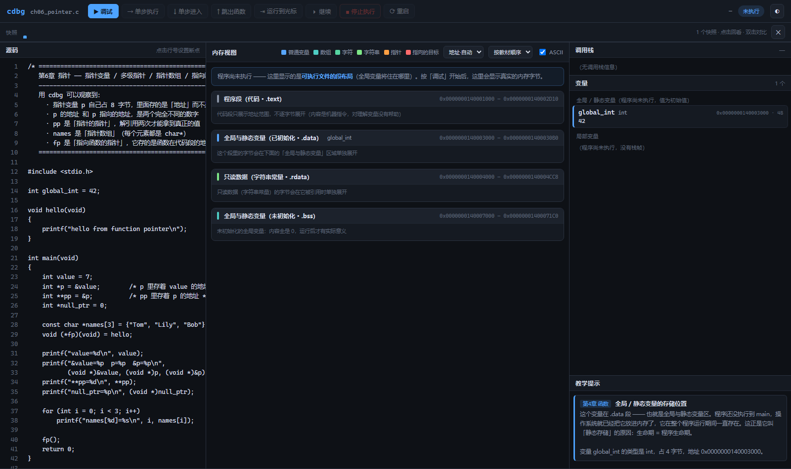
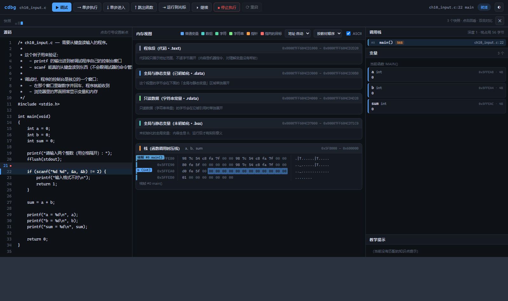
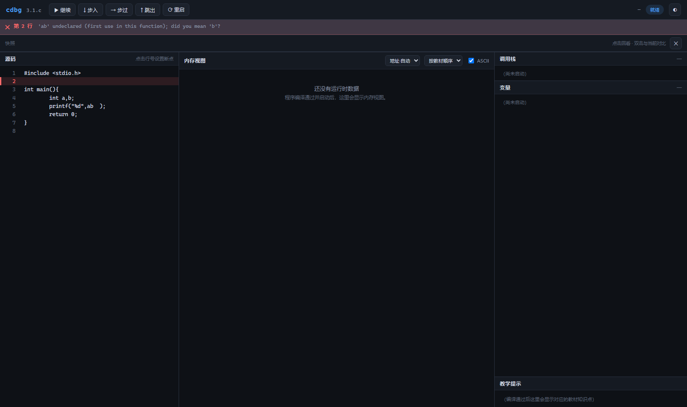
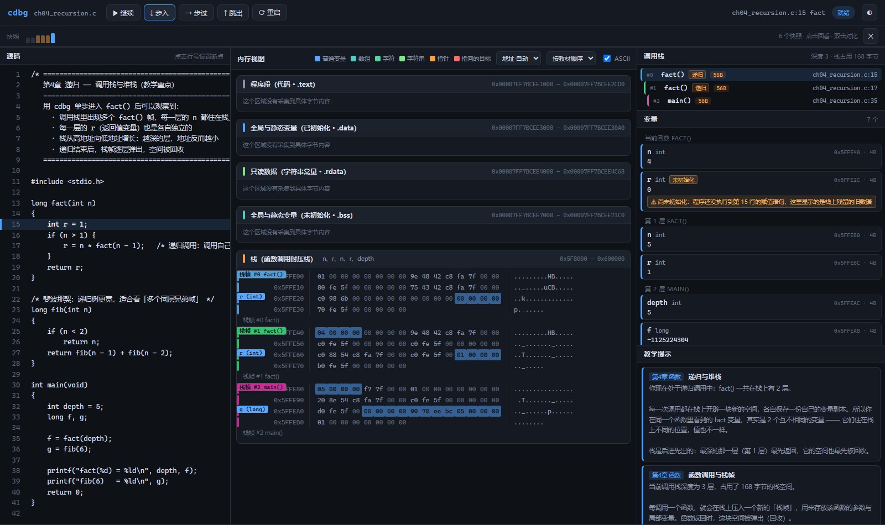
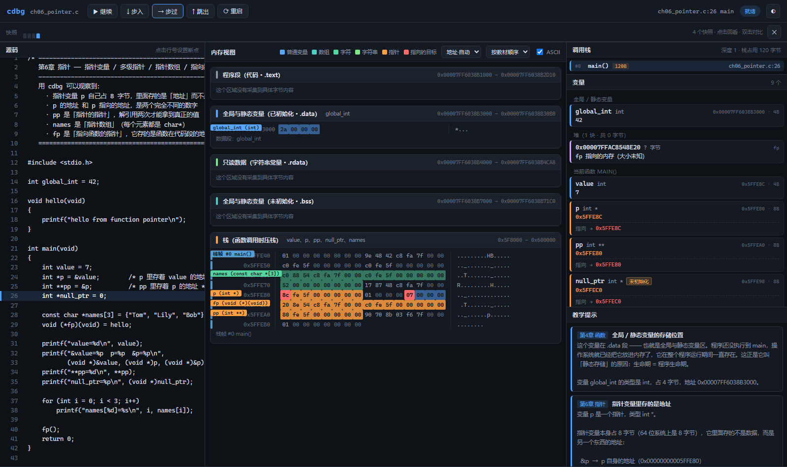
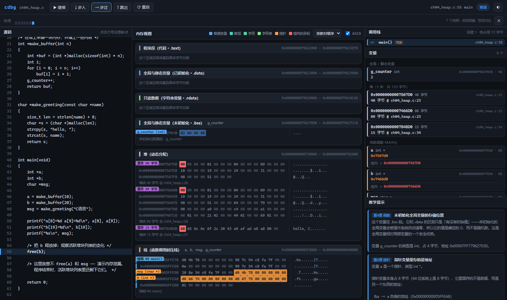

# cdbg · C 语言可视化调试器

给 C 语言初学者用的可视化调试器：**把程序的内存摊开给你看，同时和源码联动。**

> 本项目由作者设计架构，由AI完成代码编写，如有设计不当之处敬请指出。



*三栏布局：源码、内存视图、调用栈与变量。图中展示的是指针示例停在断点时的状态。*

---

## 快速开始

```bash
cd cdbg
python cdbg.py examples/ch06_pointer.c
```

浏览器会自动打开调试界面。三个面板从左到右分别是**源码**、**内存视图**、**调用栈与变量**。

### 环境要求

| 组件 | 要求 | 说明 |
|---|---|---|
| Python | 3.9+ | 只用标准库，无需 pip 安装任何东西 |
| GCC | 支持 `-g -O0` | MSYS2 UCRT64 / MinGW-w64 均可 |
| GDB | **必须带 Python 支持** | `gdb --batch -ex "python print(1)"` 能打印即合格 |

**不用手工配路径。** 第一次运行时，工具会自己扫一遍本机（PATH、Dev-C++、
VS Code、Visual Studio、常见安装目录……），挑一套带 gcc + gdb（且 gdb 带
Python）的工具链，写进 `config/toolchain.conf`。之后每次启动直接读它。

```bash
python cdbg.py --toolchain        # 看当前用的是哪套编译器/调试器
python cdbg.py --scan-compiler    # 重新扫描并交互选择（也可双击 scan_compiler.bat）
```

把整个目录拷到另一台机器也能直接跑：配置里记的是绝对路径，换台机器找不到就会自动重扫并覆盖，不用手工改。

也可以显式指定，优先级最高（临时绕过配置）：

```bash
set CDBG_CC=C:\msys64\ucrt64\bin\gcc.exe
set CDBG_GDB=C:\msys64\ucrt64\bin\gdb.exe
```

> 注意：Dev-C++ 自带的 gdb 是**没有 Python 支持**的精简版，选它会让调试界面
> 一个变量都显示不出来 —— 扫描时会自动把它排到后面，并在选择界面上标红。

---

## 常用命令

```bash
python cdbg.py prog.c                 # 编译并打开可视化界面
python cdbg.py prog.exe               # 调试已编译好的程序
python cdbg.py prog.c --no-browser    # 不自动开浏览器（自己访问打印的地址）
python cdbg.py prog.c --no-instrument # 关闭堆跟踪插桩
python cdbg.py prog.c --headless      # 终端输出模式，供 IDE 调用
python cdbg.py prog.c --port 9000     # 指定端口（默认随机）
python cdbg.py --toolchain            # 查看当前编译器 / 调试器
python cdbg.py --scan-compiler        # 重新扫描并选择工具链
```

界面快捷键（与 RedPanda Dev-C++ 一致）：

| 按钮 | 快捷键 | 作用 |
|---|---|---|
| 调试 | `F5` | 开始运行。**没有断点时停在程序入口**，有断点时停在第一个断点 |
| 单步执行 | `F7` | 走一行，不进入函数 |
| 单步进入 | `F8` | 走一行，进入函数 |
| 跳出函数 | `Ctrl+F8` | 一直跑到当前函数返回 |
| 运行到光标 | `Ctrl+F5` | 跑到你点的那一行（先点源码正文设置光标） |
| 继续 | `F4` | 跑到下一个断点；程序可能一直跑，所以点了就返回不卡界面 |
| 停止执行 | `F6` | 杀掉正在运行的程序。**长按 3 秒**=强制结束（`taskkill /F`） |
| 重启 | — | 从头再跑一遍，断点保留 |
| 清空界面 | — | 把这次调试看到的画面全清掉（源码和断点留着） |

### 「清空界面」到底清什么

清的是**这一次调试的画面**，不是文件、也不是断点：

- 清掉：当前执行行的高亮、内存视图、变量、调用栈、教学提示、**快照时间轴**，
  状态回到「未执行」；
- 保留：源码、你设的断点、程序本身（已编译好，按「调试」立刻重跑）；
- 程序还在跑的话会**先停掉**再清 —— 否则就成了「界面空了，程序在后台偷偷跑」。

清空是**真的**清空：状态记在会话里，刷新页面、或者随后点任何按钮触发状态同步，
都不会把旧快照带回来。想接着看历史就用时间轴的回看，清空等于「这一轮到此为止」。

### 停止执行：短按 / 长按

- **短按（或 F6）**：正常停止，走 GDB 的中断 + kill，实测 0.2~0.4 秒确认死透。
- **按住 3 秒**：按钮里会有一条红色进度条从左往右长满，满格时对程序执行
  `taskkill /PID <pid> /F`，**只杀被调试的程序，不杀 GDB** —— 符号表和断点都还在，
  接着按「调试」就能重来。

长按是**兜底**，平时用不上：只有在 GDB 自己也卡住时（程序陷在系统调用里、
`kill` 命令回 error），从外面把进程砍掉才能让 GDB 醒过来。

### 加载 ≠ 执行

打开一个 `.c` 文件时，程序**不动**，和 Dev-C++ 一样：先显示「未执行」，
你可以看源码、看全局变量住在内存的哪个位置、设好断点，按「调试」才开始跑。

### 程序的输入输出

被调试程序有**自己独立的**真实控制台窗口（不是浏览器里模拟的终端）：
窗口标题就是程序的完整路径，`printf` 往那儿打，`scanf` 从那儿读。

- 不会再冒出一个「gdb.exe」的黑窗口 —— GDB 自己的控制台是创建后立刻隐藏的
  （Dev-C++ 的 `Debugger.pas` 就是这么干的：`CREATE_NEW_CONSOLE` 起 gdb，
  再用 `STARTF_USESHOWWINDOW` + `SW_HIDE` 把窗口藏起来）。
- 这个独立控制台不是可有可无的装饰：GDB 靠管道和调试器通信，程序若跟
  MI 命令共用一个 stdin，`scanf` 会读到调试命令、或者直接挂死。
- 程序退出后那个窗口会随之关闭（和 Dev-C++ 调试时的行为一致）。想在退出后
看到最后那几行输出，就在最后一行下个断点，或者把输出重定向到文件。



  > **TODO**（等主要功能稳定后再做）：补上 Dev-C++ 跑程序时的那种收尾提示
  > ```
  > --------------------------------
  > Process exited after 8.978 seconds with return value 0
  > 请按任意键继续. . .
  > ```
  > 做法是另外挂一个 `AttachConsole` 到被调试进程的保活进程守着那个控制台，
  > 程序退出后由它打印这两行并等一次按键。

### 多种启动方式

1. **命令行**：`python cdbg.py hello.c`
2. **拖拽 / 打开方式**：双击 `register_openwith.bat` 注册后，右键 `.c` 文件即可
3. **IDE 调用**：`python cdbg.py hello.c --headless --port 9000`

---

## 界面说明

```
┌─────────────────────────────────────────────────────────────────┐
│ 工具栏：调试/单步执行/单步进入/跳出/运行到光标/继续/停止/重启    │
├─────────────────────────────────────────────────────────────────┤
│ 快照时间轴：每一步一个刻度，刻度高度 = 调用栈深度               │
├───────────┊──────────────────────┊──────────────────────────────┤
│           ┊                      ┊  调用栈（阶梯式缩进）        │
│   源码    ┊      内存视图        ┊  ─────────────────           │
│           ┊                      ┊  变量（按帧分组）            │
│  当前行蓝 ┊  程序段 / 全局静态   ┊  ─────────────────           │
│  光标行绿 ┊  堆 / 栈             ┊  教学提示                    │
│  点行号设断点  HEX 网格 + ASCII   ┊  （挂到教材章节）            │
└───────────┊──────────────────────┊──────────────────────────────┘
            ↑ 拖动改宽度，双击还原
```

三栏的宽度可以拖动中间那两条分隔线来调，比例记在 localStorage 里，
下次打开还是这个宽度；拖歪了双击分隔条就回到默认的 26% / 52% / 22%。

### 两种高亮，两种颜色

| 高亮 | 颜色 | 含义 |
|---|---|---|
| 当前执行行 | 蓝 | 程序**停**在这一行（PC 所在位置） |
| 光标行 | 绿 | 鼠标点选的那一行，「运行到光标」的目标 |

两者撞在同一行时，底色用蓝、右边补一条绿边 —— 说明光标也压在这儿。

### 内存视图的配色

| 颜色 | 含义 |
|---|---|
| 蓝 | 普通整型变量 |
| 青 | 数组 |
| 绿 | 字符 / 字符串 |
| 橙 | **指针变量**（它自己占的那几个字节） |
| 红 | **指针指向的目标**（被指向的那块内存） |
| 紫 | 堆块 |
| 彩色竖条 | 栈帧边界 —— 每一层递归调用一个颜色 |

橙色到红色的箭头线，就是「指针指向谁」。指针的目标要是被渲染出来了，
就从指针的字节画一条走行距的折线过去，末端带箭头；目标跨了分区、或者隔了
太多行，就改骑在标签旁边挂一枚虚线徽标（`→ 变量名` / `→ 视图外`）——
那种长度要竖着穿过好几个分区标题，画出来反而像渲染错乱。

「全局与静态」两个分区里既有文件作用域的变量，也有**函数里的 `static`**：
它们的生命周期是全局的，存储位置也在这里（初始化过的在 `.data`，
没初始化的在 `.bss`），只是作用域限于那个函数。

变量本身不再压在字节上：每行右侧列出这一行起始的变量（栈帧边界也一起挪过去），
标签只写变量名（类型由底色表示，鼠标停上去能看到完整类型和地址），
用一根细线指回它的起始字节。右侧这块宽度是固定的（36%），
所以每行的标签右边缘永远对齐成一条竖线，变量多的行也不会把行撑破。线走在行的下半段空档里（行高 34px，内容只占上面
20px），所以不会压到字上；多根线依次错开，不会叠成一条。鼠标指到标签、字节或
地址上，对应的变量、地址和那根线会一起亮起来 —— 想看清某个字节归谁管时很好用。

一个变量占的连续字节会拼成一整条长方形（只有首尾带圆角），而不是一格一格的
小方块 —— 一眼能看出「这块是一个变量」。

### 程序在等输入的时候

执行 `scanf` 这类会阻塞的调用时，程序在等键盘输入，前端只能干等到超时，
工具栏的按钮会一直灰着。这时候按钮右边会出现一行蓝色提示：

> 指令运行中，请检查程序是否在等待输入，如果是，请到控制台输入一些字符

普通命令几十毫秒就返回，所以这行字延迟 0.6 秒才出现，不会每点一下闪一下。
看到它就去程序的控制台窗口敲点东西，程序继续跑，提示会自动消失。

### 地址怎么显示

完整地址是 `0x00007FF685221000` 这种 16 位十六进制，太长。工具栏的
「地址」下拉框有三种模式：

- **自动**（默认）—— 高 32 位为 0 就折叠成紧凑形式，否则展开成完整 16 位。
  于是栈、堆这些低地址显示成 `0x5F8000`，代码段这些高地址保持 `0x00007FF6…`
- **紧凑** —— 一律去掉前导零（`0x7FF685221000`）
- **完整** —— 一律 16 位（`0x00007FF685221000`）

选择会记住，下次打开沿用。

### 编译不过也能用

程序编译不通过时，工具照样打开界面：

- 顶部的红条列出每一条错误
- 源码面板里**出错的行直接标红**
- 右侧给出**原因解释**，而不只是把编译器日志糊你一脸

链接错误（`ld returned 1 exit status`）MinGW 会把真正的原因吞掉，
这里会自己查一遍：



- 源文件里没有 `main()` → 提示检查函数名拼写
- 符号定义在同目录的另一个 `.c` 里 → 告诉你该和哪个文件一起编译，
  并**自动把它们一起编译**
- 符号在别的文件里是 `static` 定义的 → 指出 static 变量无法跨文件访问，
  这正是教材里 `extern` 与 `static` 冲突的经典错误

---

## 教学功能

界面的右栏会把当前的内存状态翻译成教材语言，右下角还标了对应章节。

### 第 4 章 · 函数



- **变量存储类型** —— 全局变量在 `.data`、未初始化的在 `.bss`、局部变量在栈上，
  「存储位置即标签」直接对应书里那张存储类型表
- **参数按值传递** —— 被调用函数栈帧里的参数是调用者变量的副本，地址不同
- **函数调用与栈帧** —— 调用栈深度、每层占多少字节、栈从高地址往低地址长
- **递归与堆栈** —— 同一函数的多层调用在栈上各自独立，变量地址各不相同
- **栈与堆的分工** —— 两者同时出现时给出对照说明

### 第 5 章 · 数组

- 数组元素在内存里**紧挨着**排列，地址差正好是元素大小
- 数组传进函数会**退化成指针**，函数只知道首地址

### 第 6 章 · 指针



- 指针变量自己占 8 字节，里面存的是**地址**而不是数据
- `&` 取的是指针自己的地址，`*` 解引用得到的是目标 —— 两者在视图里分开标注
- **多级指针**：`int **pp` 的指向链逐层展开
- **指针数组 vs 指向数组的指针**：括号位置决定含义，视图里会标出偏移

### 第 7 章 · 字符串

- 字符串常量在 `.rdata`（只读区），**不在栈上也不在堆上**
- 字符数组 vs 字符指针的本质区别
- `char*` 指向字面量时，往里写会崩

### 附加功能

- **未初始化检测** —— 局部变量在执行到声明语句之前，值是栈上残留的垃圾数据，
  界面会明确标出「尚未初始化」，并解释为什么全局变量反而是 0
- **空指针 / 悬垂指针** —— 指针指向的地址不落在任何已知区域时给出警告
- **堆跟踪** —— 每块堆内存的地址、大小、以及**它是在哪一行申请出来的**



- **快照时间轴** —— 每一步存一份，可回看；双击任意快照与当前状态对比，
  列出所有变量的变化

---

## 示例程序

`examples/` 里每章都有配套的示例，直接拿来调试即可：

| 文件 | 演示内容 |
|---|---|
| `ch04_func.c` | 变量存储类型、参数传值、返回值 |
| `ch04_recursion.c` | **递归与堆栈**（教学重点） |
| `ch04_heap.c` | malloc / free 的生命周期与内存泄漏 |
| `ch05_array.c` | 数组连续布局、数组传参退化 |
| `ch06_pointer.c` | 指针、多级指针、指针数组、函数指针 |
| `ch07_string.c` | 字符串常量、字符数组 vs 字符指针 |
| `ch08_struct.c` | 结构体对齐与填充字节（选做） |
| `ch09_file.c` | 文件与缓冲区（选做） |

---

## 目录结构

```
cdbg/
├─ cdbg.py                    主入口：编译 → 起 GDB → 起 Web → 开浏览器
├─ cdbg/
│  ├─ launcher.py             编译流程、ASCII 工作目录管理
│  ├─ instrument.py           源码插桩（堆跟踪）
│  ├─ gdb_session.py          MI2 会话管理、命令收发
│  ├─ gdb_probe.py            嵌入 GDB 的采集脚本（变量/栈帧/内存/段）
│  ├─ collector.py            采集结果 → Snapshot 的聚合层
│  ├─ memmap.py               外部进程内存布局（堆/栈真实边界）
│  ├─ heap_ledger.py          堆账本解析
│  ├─ curriculum.py           教材知识点映射（提示文案的唯一来源）
│  ├─ snapshot.py             数据模型
│  ├─ session.py              调试会话编排
│  ├─ web_server.py           HTTP + REST + SSE
│  └─ browser.py              打开浏览器
├─ web/                       前端（纯静态，无构建步骤）
│  ├─ index.html  theme.css
│  ├─ app.js                  主逻辑与状态管理
│  ├─ memview.js              HEX 网格、变量着色、指针连线
│  ├─ sourceview.js           源码面板
│  ├─ varpanel.js             变量卡片、调用栈
│  └─ timeline.js             快照时间轴与变量 diff
├─ shim/                      堆跟踪插桩的 shim 头与实现
├─ examples/                  各章示例程序
└─ tests/                     端到端测试
```

---

## 实现要点

### 为什么是「附加调试器」而不是 attach

GDB 在 Windows 上 attach 到已有进程会被系统拒绝（`error 5`，Access Denied）。
所以 cdbg 采用 **launch 模式**：由 cdbg 启动被调试程序，然后全程伴随它运行。
这和 IDE 里「用调试器启动程序」是同一件事。

### 执行控制与数据采集为什么分开

- **执行控制**用 GDB 的 **MI2 协议**（`-exec-run` / `-exec-next` / `-break-insert`）
- **数据采集**用 **GDB 内嵌的 Python 探针**

两者通过一个约定好的 JSON 文件解耦：程序每次停下来，探针就把快照原子写入文件，
主进程读文件。这样避免 MI 与 console 解释器混用导致的输出交错。

### 源码插桩安全吗

堆跟踪会在源码里插入**一行** `#include "cdbg_shim.h"`，用户代码一行不改。
安全上有五重保障：

1. shim 头里**先 include 标准库、再定义宏** —— 不会被宏污染到声明
2. 插入点选在**最后一个 `#include` 之后** —— 标准库头都已加载完毕
3. 检测到用户**自己定义了 malloc / free** 时直接放弃插桩
4. 插桩后**编译失败会自动降级**为不插桩重编一次
5. 插桩只做「记录」，**不改变任何内存布局或执行顺序**

### 几个必须知道的坑（都已在代码里处理）

- **GDB 在中文路径下会直接崩溃**（内部用 GBK 解码 Unicode）。
  所以源码一律复制到纯 ASCII 的临时工作目录再编译，界面仍显示原始路径。
- **Windows 上真实地址顺序与教科书相反** —— 代码段在高位（`0x7FF6…`），
  栈在低位（`0x5FF8…`），而经典示意图是代码段在低位。
  界面因此按**教材逻辑顺序**分区（程序段 → 全局静态 → 堆 → 栈），
  但每个区块都标注真实地址，可切换成「按真实地址」排序。
- **`%p` 的输出格式**是 16 位大写十六进制、无 `0x` 前缀，而 GDB 用
  `0x00007ff6…`。界面统一成 `0x` + 大写，并另外提供 printf 形式对照。
- **Windows 上 GDB 拿不到进程内存布局** —— `info proc mappings` 无输出，
  `inferior.memory_regions()` 不存在。堆栈的真实边界改用
  `VirtualQueryEx` 从进程外部查询。
- **断点会「吸附」，不会精确落在你点的那一行**。`break file:18` 实际是
  「第 18 行之后第一个有机器码的位置」：空行、纯声明行（`int b;`）、
  `static int c = 0;` 都会被跳过。所以界面上显示的断点、以及「运行到光标」
  之后的光标位置，用的都是 GDB 回报的真实落点（`bkpt.line`），
  否则会出现「断点点在 18 行、程序停在 19 行」的错层。
- **函数里的 `static` 变量不在 GDB 的 global/static block 里** ——
  它挂在函数自己的 block 上，顺着 block 链往上走也拿不到。这类变量
  只能从当前栈帧的可见变量里认出来，再按地址归到 `.data` / `.bss`
  （未初始化的 `static` 在 `.bss`）。不补这一路，变量面板有地址、
  内存视图却是空的。

---

## 测试

```bash
python tests/test_e2e.py              # 端到端：指针指向、递归栈帧
python tests/test_batch.py            # 批量测 examples/
python tests/test_batch.py D:/cdesign # 批量测任意目录
```

批量测试对每个源文件走四关：**编译 → 启动 → 停在 main → 采集到变量信息**。
源程序本身有编译错误时，只要工具能定位到出错位置（文件/行号/原因），
就算它工作正常 —— 源程序的错不是工具的错。

已验证：`D:/cdesign` 下 54 个自写程序全部通过（其中 3 个源程序本身
有编译错误，被准确诊断并定位到行）。

---

## 已知限制

- 目前只支持 Windows（内存布局采集用了 `VirtualQueryEx`）
- 只支持 C，GDB attach 不支持；`.cpp` 文件请先用 `gcc -x c` 转换
- 堆跟踪依赖 `malloc`/`free` 宏重定向；用了自定义分配器的程序不会有堆账本
- `.text`（代码段）只展示前 192 字节作示意，不做反汇编
- 多文件工程：工具会自动把定义了缺失符号的 `.c` 一起编译，
  但只支持「一个主文件 + 若干辅助文件」这种简单结构

---

## 计划中（TODO）

> 以下是还没做的想法，不是当前功能。

- **两种发布包**：现在只有免安装的 `cdbg-windows-x64.zip`（不带编译器，用本机的
  gcc/gdb）。打算再出一个 **with runtime** 版本，把 MinGW-w64 的 gcc 和 gdb
  一起打进去，解压就能调试，不用先装编译器；原本那个改叫 **without runtime**，
  体积小，给已经配好环境的人用。
- **编译器不合适时自动补一套**：without runtime 版如果发现本机只有 MSVC
  （Visual Studio 的 `cl.exe`），要能自己拉取一份 MinGW 放到本地再用。原因是
  MSVC 产出的是 PDB 调试信息，GDB 读不了——用它编译的程序看不到变量、行号和
  调用栈，等于没调试。拉取的文件要有哈希校验，考虑到国内下载慢，还得支持镜像源。
- 内置 gcc/gdb 属于把两个 GPL v3 程序和你自己的程序打包分发，是 GPL 说的
  "mere aggregation"（单纯聚合），**不要求本项目也改成 GPL**。MIT 保持不变；
  但分发时要把 gcc/gdb 各自的许可证文本、版权声明和源码获取途径一并提供。

---

## 参与开发

想改代码或接手维护，从 [`CONTRIBUTING.md`](CONTRIBUTING.md) 开始——环境、本地跑法、
改代码的硬规矩、测试、云端构建都在那里；架构和已知的坑见 [`DEVREADME.md`](DEVREADME.md)。

## 许可证与致谢

本项目使用 [MIT License](LICENSE)。

交互设计参考了 [Red Panda Dev C++（小熊猫 Dev-C++）](https://github.com/royqh1979/RedPanda-CPP)
的快捷键语义、GDB 启动方式和工具链字段命名，目的是让 C 语言初学者从 Dev-C++
切过来不用重新学。上游项目以 GPL v3 发布；本项目是独立的 Python/HTML 实现，
未包含其源码，只参考了行为设计。`Dev-CPP-master.zip` 那份源码包仅作参考，
不随项目分发。
